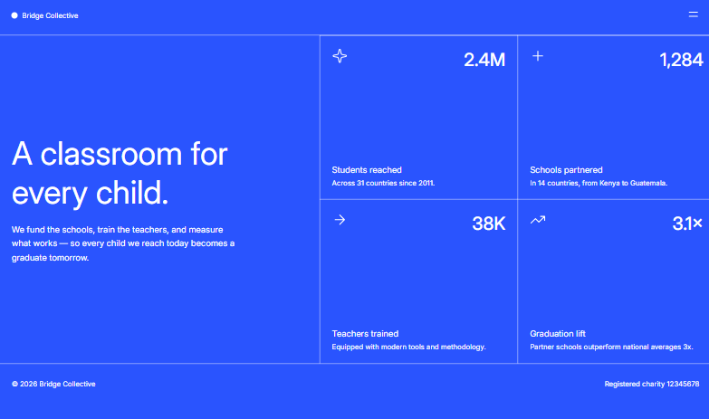
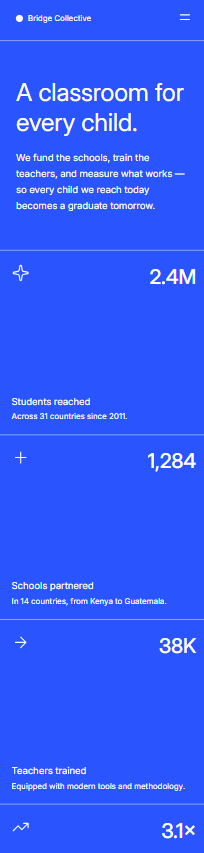

# Frontend Mentor - Solución de Grid landing page

[English](./README.md) | **Español**

Esta es mi solución al reto [Grid landing page de Frontend Mentor](https://www.frontendmentor.io/challenges/grid-landing-page). El objetivo fue construir una landing page responsive para una organización educativa ficticia utilizando únicamente HTML y CSS.

## Tabla de contenidos

- [Descripción general](#descripción-general)
  - [El reto](#el-reto)
  - [Capturas](#capturas)
  - [Enlaces](#enlaces)
- [Mi proceso](#mi-proceso)
  - [Tecnologías utilizadas](#tecnologías-utilizadas)
  - [Decisiones principales](#decisiones-principales)
  - [Lo que aprendí](#lo-que-aprendí)
  - [Desarrollo futuro](#desarrollo-futuro)
  - [Recursos útiles](#recursos-útiles)
  - [Colaboración con IA](#colaboración-con-ia)
- [Autor](#autor)

## Descripción general

### El reto

Los usuarios deben poder:

- Ver una distribución adecuada de la página según el tamaño de su pantalla.
- Abrir y cerrar el menú de navegación sin depender de JavaScript.
- Ver estados `hover` y `focus-visible` en los elementos correspondientes.
- Consultar el contenido sin desbordamientos horizontales desde pantallas de 320px.
- Navegar por los elementos interactivos utilizando un teclado.

### Capturas

#### Escritorio



#### Móvil



### Enlaces

- Repositorio de la solución: [GitHub - Grid landing page](https://github.com/JesuSaid/Grid-landing-page)
- Sitio publicado: [Grid landing page](https://jesusaid.github.io/Grid-landing-page/)

## Mi proceso

### Tecnologías utilizadas

- HTML5 semántico
- Propiedades personalizadas de CSS
- CSS Grid
- Flexbox
- Propiedades lógicas de CSS
- Flujo de trabajo mobile-first
- Fuente variable local con `@font-face`
- Convención de nombres BEM
- Commits de Git organizados alrededor de hitos significativos

El proyecto no utiliza JavaScript. El menú de navegación se implementó con los elementos nativos `details` y `summary`.

### Decisiones principales

#### Estructura semántica

La página se organizó con `header`, `nav`, `main`, `section`, una lista de estadísticas y `footer`. Los iconos de las estadísticas son decorativos, por lo que utilizan texto alternativo vacío.

Las estadísticas se marcaron como una lista porque forman una colección de datos relacionados y no un grupo de contenedores sin significado.

#### Navegación sin JavaScript

Para mantener la solución limitada a HTML y CSS, utilicé `details` y `summary`. Estos elementos nativos permiten abrir y cerrar el menú mediante un puntero o un teclado.

```html
<details class="site-nav">
  <summary class="site-nav__toggle" aria-label="Navigation menu">
    <!-- Iconos del menú -->
  </summary>
  <nav class="site-nav__panel">
    <!-- Enlaces de navegación -->
  </nav>
</details>
```

#### Cuadrícula de estadísticas

Cada tarjeta de estadísticas utiliza su propia cuadrícula. Esto permite colocar el icono y el valor en la parte superior, conservar una fila flexible en el centro y posicionar la etiqueta y la descripción en la parte inferior sin añadir contenedores exclusivamente para la presentación.

```css
.stats__item {
  display: grid;
  grid-template-columns: 1fr 1fr;
  grid-template-rows: auto 1fr auto auto;
}
```

En pantallas amplias, la colección de estadísticas cambia a una cuadrícula de dos columnas y dos filas.

#### Flujo mobile-first

Los estilos base están dirigidos a pantallas pequeñas. Las mejoras para la navegación, el footer y el contenido principal se añadieron mediante media queries con `min-width`.

El layout se probó a 320px, 375px, 768px y 1440px. También se revisaron anchos cercanos a los breakpoints para evitar cambios inesperados.

#### Sistema de diseño

Los colores, la tipografía y los tamaños reutilizables de los componentes se centralizaron en `:root`. Las propiedades personalizadas usan nombres semánticos como `--color-background`, `--color-text` y `--header-block-size`.

Las propiedades lógicas `min-block-size`, `padding-inline-end`, `border-block-start` y `border-inline-start` describen el layout de acuerdo con la dirección de escritura.

### Lo que aprendí

- Comenzar con HTML semántico facilita la implementación visual.
- Mobile-first consiste en crear una base funcional para pantallas pequeñas y mejorarla progresivamente.
- Un breakpoint debe elegirse según el espacio que necesita el contenido, no solamente por el nombre de un dispositivo.
- CSS Grid puede colocar contenido en filas y columnas sin añadir contenedores innecesarios.
- Una fila con `1fr` puede absorber el espacio disponible y empujar otros elementos hacia extremos opuestos.
- Los porcentajes, `auto` y las unidades fraccionarias de Grid no expresan el mismo comportamiento de tamaño.
- Las propiedades lógicas hacen que los estilos sean más adaptables y comunican mejor su propósito.
- Es importante comprender los estilos nativos de las listas, los párrafos y `summary` antes de reemplazarlos.
- Los estados de foco del teclado son tan importantes como los estados hover para una navegación accesible.
- Las variables CSS resultan más útiles cuando representan decisiones reutilizables del diseño.
- Probar varios anchos de viewport ayuda a descubrir desbordamientos y cambios inesperados entre breakpoints.
- Los commits son más claros cuando representan hitos completos, como la navegación, el footer o el layout responsive, en lugar de cambios en archivos individuales.

### Desarrollo futuro

En proyectos futuros quiero continuar practicando:

- Elección de breakpoints basada en el contenido.
- Uso de `min()`, `max()`, `calc()` y `clamp()` cuando hagan más claros los valores responsive.
- Pruebas de accesibilidad con teclados y lectores de pantalla.
- Respeto de `prefers-reduced-motion` al añadir animaciones.
- Validación de HTML y CSS antes de publicar.
- Comparación más precisa entre las implementaciones y las referencias de diseño.

### Recursos útiles

- [MDN - CSS Grid Layout](https://developer.mozilla.org/en-US/docs/Web/CSS/CSS_grid_layout) - Me ayudó a comprender las filas, columnas, tracks y colocación de elementos en Grid.
- [MDN - Responsive design](https://developer.mozilla.org/en-US/docs/Learn_web_development/Core/CSS_layout/Responsive_Design) - Una introducción útil a los layouts responsive y las media queries.
- [MDN - CSS logical properties](https://developer.mozilla.org/en-US/docs/Web/CSS/CSS_logical_properties_and_values) - Referencia para propiedades que tienen en cuenta la dirección de escritura.
- [MDN - El elemento details](https://developer.mozilla.org/en-US/docs/Web/HTML/Reference/Elements/details) - Documentación del elemento nativo utilizado por el menú de navegación.
- [Frontend Mentor](https://www.frontendmentor.io/) - Proporcionó el reto, las referencias visuales y los recursos del proyecto.

### Colaboración con IA

Utilicé ChatGPT/Codex como mentor de desarrollo y herramienta de revisión. Me ayudó a:

- Revisar cambios incrementales de HTML y CSS.
- Comprender conceptos de HTML semántico, accesibilidad, Flexbox y Grid.
- Identificar posibles desbordamientos y problemas entre breakpoints.
- Comparar decisiones de implementación con los diseños proporcionados.
- Organizar el trabajo en commits significativos.
- Considerar mejoras sin reemplazar el proceso de escribir y probar el código por mi cuenta.

El proyecto se desarrolló de forma incremental. Implementé y verifiqué cada decisión para comprender por qué funcionaba en lugar de copiar una solución completa generada.

## Autor

- GitHub: [@JesuSaid](https://github.com/JesuSaid)
