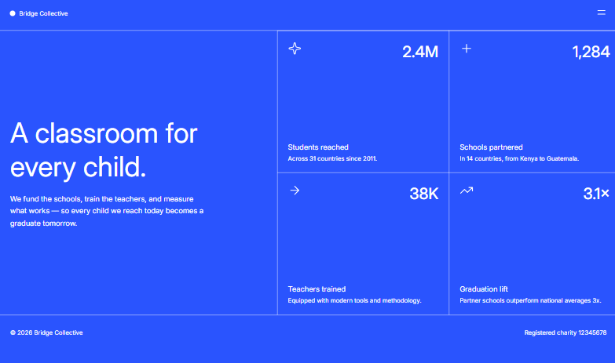
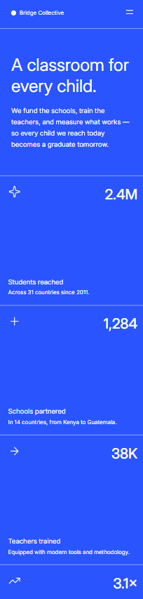

# Frontend Mentor - Grid landing page solution

**English** | [Español](./README-es.md)

This is my solution to the [Grid landing page challenge on Frontend Mentor](https://www.frontendmentor.io/challenges/grid-landing-page). The goal was to build a responsive landing page for a fictional education nonprofit using only HTML and CSS.

## Table of contents

- [Overview](#overview)
  - [The challenge](#the-challenge)
  - [Screenshots](#screenshots)
  - [Links](#links)
- [My process](#my-process)
  - [Built with](#built-with)
  - [Key decisions](#key-decisions)
  - [What I learned](#what-i-learned)
  - [Continued development](#continued-development)
  - [Useful resources](#useful-resources)
  - [AI collaboration](#ai-collaboration)
- [Author](#author)

## Overview

### The challenge

Users should be able to:

- View an optimal layout for the page depending on their screen size.
- Open and close the navigation menu without relying on JavaScript.
- See hover and focus-visible states for the relevant elements.
- View the content without horizontal overflow from 320px wide screens.
- Navigate the interactive elements with a keyboard.

### Screenshots

#### Desktop



#### Mobile



### Links

- Solution repository: [GitHub - Grid landing page](https://github.com/JesuSaid/Grid-landing-page)
- Live site: [Grid landing page](https://jesusaid.github.io/Grid-landing-page/)

## My process

### Built with

- Semantic HTML5 markup
- CSS custom properties
- CSS Grid
- Flexbox
- CSS logical properties
- Mobile-first workflow
- A locally hosted variable font with `@font-face`
- BEM naming convention
- Git commits organized around meaningful milestones

The project does not use JavaScript. The navigation menu was implemented with the native `details` and `summary` elements.

### Key decisions

#### Semantic structure

The page is organized with `header`, `nav`, `main`, `section`, a list of statistics, and `footer`. The statistic icons are decorative, so they use empty alternative text.

The statistics are marked up as a list because they form a collection of related data rather than a group of containers without meaning.

#### Navigation without JavaScript

To keep the solution limited to HTML and CSS, I used `details` and `summary`. These native elements allow the menu to be opened and closed with either a pointer or a keyboard.

```html
<details class="site-nav">
  <summary class="site-nav__toggle" aria-label="Navigation menu">
    <!-- Menu icons -->
  </summary>
  <nav class="site-nav__panel">
    <!-- Navigation links -->
  </nav>
</details>
```

#### Statistics grid

Each statistic card uses its own grid. This places the icon and value at the top, leaves a flexible track in the middle, and positions the label and description at the bottom without adding presentation-only containers to the HTML.

```css
.stats__item {
  display: grid;
  grid-template-columns: 1fr 1fr;
  grid-template-rows: auto 1fr auto auto;
}
```

On wider screens, the statistics collection becomes a two-column, two-row grid.

#### Mobile-first workflow

The base styles target small screens. Enhancements for the navigation, footer, and main content are added with `min-width` media queries.

The layout was tested at 320px, 375px, 768px, and 1440px. Widths close to the breakpoints were also checked to avoid unexpected layout jumps.

#### Design system

Reusable colors, typography, and component sizes are centralized in `:root`. The custom properties use semantic names such as `--color-background`, `--color-text`, and `--header-block-size`.

Logical properties such as `min-block-size`, `padding-inline-end`, `border-block-start`, and `border-inline-start` describe the layout according to the writing direction.

### What I learned

- Starting with semantic HTML makes the visual implementation easier to reason about.
- Mobile-first means creating a functional small-screen base and progressively enhancing it.
- A breakpoint should be chosen according to the space required by the content, not only by device labels.
- CSS Grid can position content in rows and columns without adding unnecessary wrappers.
- A `1fr` track can absorb available space and push other elements toward opposite ends.
- Grid percentages, `auto`, and fractional units do not express the same sizing behavior.
- Logical properties make styles more adaptable and communicate their purpose more clearly.
- Native styles on lists, paragraphs, and `summary` should be understood before overriding them.
- Keyboard focus states are as important as hover states for accessible navigation.
- CSS variables are most useful when they represent reusable design decisions.
- Testing several viewport widths helps reveal overflow and unexpected changes between breakpoints.
- Commits are clearer when they represent complete milestones such as navigation, footer, or responsive layout instead of individual file changes.

### Continued development

In future projects, I want to continue practicing:

- Choosing breakpoints based on the content.
- Using `min()`, `max()`, `calc()`, and `clamp()` when they make responsive values clearer.
- Testing accessibility with keyboards and screen readers.
- Respecting `prefers-reduced-motion` when adding animations.
- Validating HTML and CSS before publishing.
- Comparing implementations with design references more precisely.

### Useful resources

- [MDN - CSS Grid Layout](https://developer.mozilla.org/en-US/docs/Web/CSS/CSS_grid_layout) - Helped me understand grid tracks, rows, columns, and item placement.
- [MDN - Responsive design](https://developer.mozilla.org/en-US/docs/Learn_web_development/Core/CSS_layout/Responsive_Design) - A useful overview of responsive layouts and media queries.
- [MDN - CSS logical properties](https://developer.mozilla.org/en-US/docs/Web/CSS/CSS_logical_properties_and_values) - Reference for writing-direction-aware properties.
- [MDN - The details element](https://developer.mozilla.org/en-US/docs/Web/HTML/Reference/Elements/details) - Documentation for the native element used by the navigation menu.
- [Frontend Mentor](https://www.frontendmentor.io/) - Provided the challenge, design references, and project assets.

### AI collaboration

I used ChatGPT/Codex as a development mentor and review tool. It helped me:

- Review incremental HTML and CSS changes.
- Understand semantic HTML, accessibility, Flexbox, and Grid concepts.
- Identify possible overflow and breakpoint issues.
- Compare implementation decisions with the supplied designs.
- Organize the work into meaningful Git commits.
- Consider improvements without replacing the process of writing and testing the code myself.

The project was developed incrementally. I implemented and verified each decision so that I understood why it worked instead of copying a complete generated solution.

## Author

- GitHub: [@JesuSaid](https://github.com/JesuSaid)
